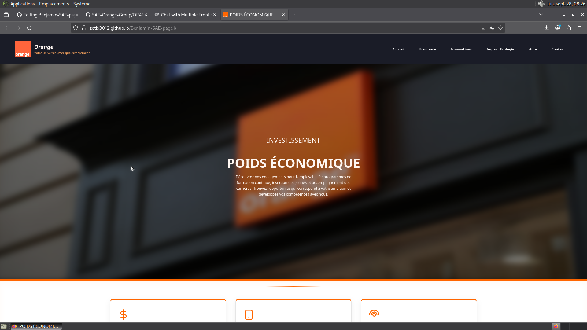

# Page Économie — Projet SAE


 **[ Cliquez ici pour voir la page en ligne](https://zetix3012.github.io/Benjamin-SAE-page1/)**

---

## Aperçu du projet



---

##  À propos du projet

Cette page a été développée par **Benjamin** dans le cadre d'une **SAE** (Situation d'Apprentissage et d'Évaluation). 

Elle propose :
* **Une présentation claire et synthétique** des sujets économiques abordés.
* **Des cartes interactives** au survol/clic qui renvoient directement aux paragraphes correspondants.

---

## Technologies utilisées

*  **HTML5** : Structuration sémantique de la page et de ses sections.
*  **CSS3** : Mise en page, animations fluides, gestion des couleurs et adaptabilité.

---

## Comment lancer le projet en local ?

1. Clonez le dépôt GitHub :
   ```bash
   git clone https://github.com/Zetix3012/Benjamin-SAE-page1.git
